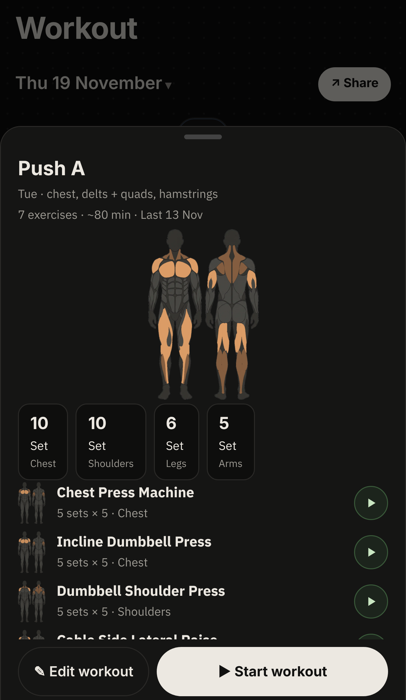
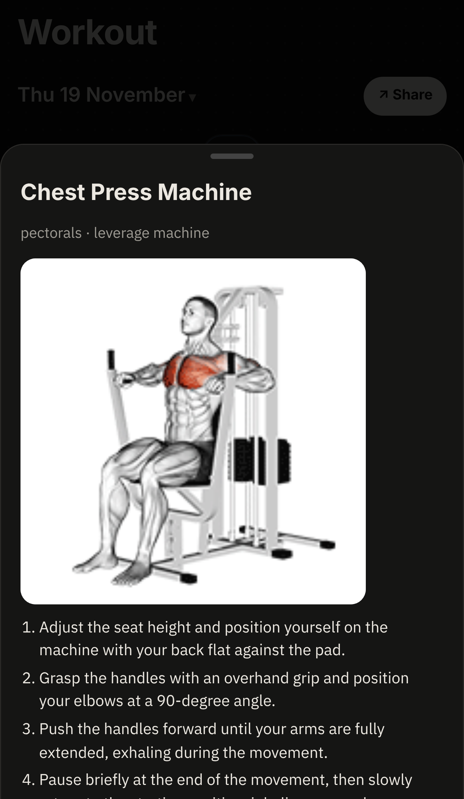
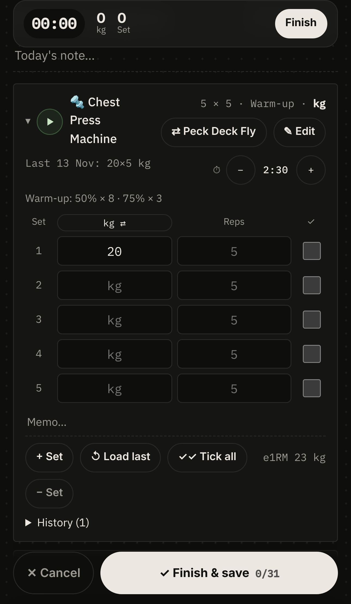
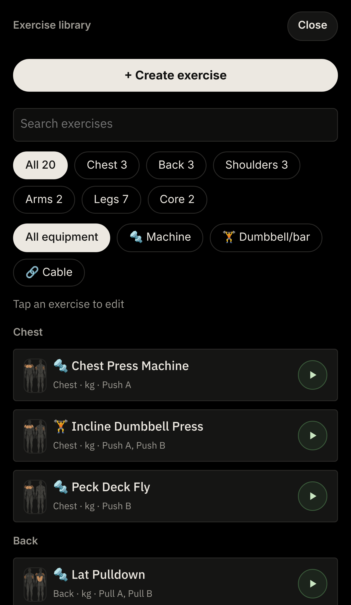

# Spec: ซ่อนรูปท่า — เปิดผ่านไอคอน ▶ How to

| แผ่นโปรแกรม | แตะ ▶ | การ์ดท่าตอนเล่น | คลังท่า |
|---|---|---|---|
|  |  |  |  |

## พฤติกรรม
- **ไม่มี GIF ในรายการ/การ์ดใด** — ช่องรูปเดิมแทนด้วย **หุ่นกล้ามเล็ก** (มัดหลักส้ม, รองน้ำตาล)
- ท่าที่มีวิธีเล่น (GIF จากชุด ex101 หรือมีลิงก์ YouTube/TikTok) มีปุ่ม **▶** วงกลมสีเขียว 34 pt (พื้นที่กดขยาย 6 pt รอบ)
- แตะ ▶ → แผ่นเลื่อนขึ้น: ชื่อท่า · กล้ามเป้าหมาย · อุปกรณ์ · GIF (กว้างสุด 320) · ขั้นตอนเป็นข้อ · ปุ่มลิงก์ (ถ้ามี) · ปิด
- แตะ ▶ ในแถวที่กดได้ (คลังท่า) จะไม่ไปเปิดแถวนั้นด้วย

## ที่เปลี่ยน
| ที่ | เดิม | ใหม่ |
|---|---|---|
| แผ่นโปรแกรม | GIF + หุ่นเล็ก | หุ่นเล็ก + ▶ ท้ายแถว |
| การ์ดท่าตอนเล่น | GIF หน้าชื่อ + กล่อง How to แบบพับ | ▶ หน้าชื่อ (เอากล่องพับออก) |
| คลังท่า (รายการ + ชุด ex101) | GIF 48 px | หุ่นเล็ก + ▶ ท้ายแถว |
| ฟอร์มแก้ท่า | กล่อง How to แบบพับ | ปุ่ม "▶ วิธีเล่น" |
| แผ่นกล้ามเนื้อ / 1RM เด่น | GIF | หุ่นเล็ก + ▶ |

## ข้อมูล
ไม่มีการเปลี่ยนแปลง

## ข้อความ
วิธีเล่น / How to (มีอยู่แล้ว)
