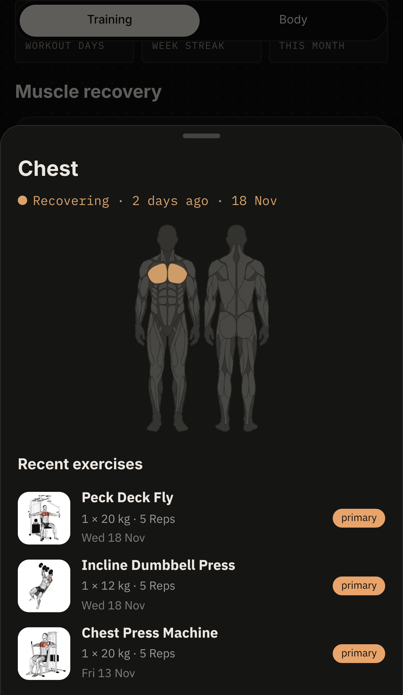
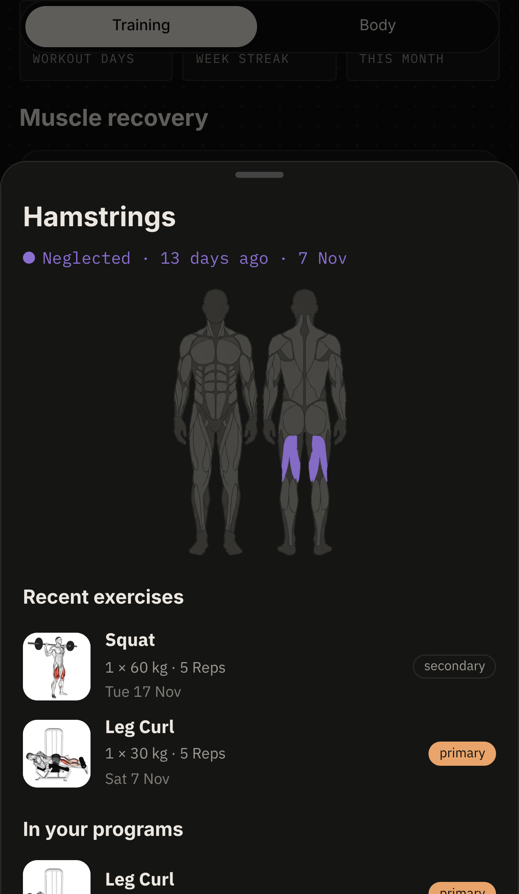

# Spec: แตะมัดกล้าม → แผ่นเลื่อนขึ้น

| อก (กำลังฟื้น) | ต้นขาหลัง (ละเลย) |
|---|---|
|  |  |

## พฤติกรรม
- แตะช่องมัดในการ์ดการฟื้นตัว → แผ่นเลื่อนขึ้นจากล่าง (ใช้แผ่นกลาง `gen-sheet` ตัวเดียวกับ 1RM/บันทึกร่างกาย)
- การ์ดการฟื้นตัว: ไม่มีกล่องรายละเอียดแทรกแล้ว, หุ่นในการ์ดแสดงทุกมัดตามสี (ไม่ isolate), ตารางไม่ขยับ
- ปิด: แตะพื้นหลัง / ลากลง / ปุ่ม "ปิด"

## เนื้อหาในแผ่น (บน → ล่าง)
1. **ชื่อมัด** ตัวใหญ่
2. **สถานะ** จุดสี + ชื่อสถานะ · กี่วันก่อน · วันที่ (สีเดียวกับตาราง)
3. **หุ่นใหญ่ (220 px)** ระบายเฉพาะมัดนี้ด้วยสีสถานะ (ยังไม่เคยเล่น → ใช้สีม่วงให้เห็นตำแหน่ง)
4. **ท่าที่เล่นล่าสุด** (สูงสุด 6, ใหม่ → เก่า) — ท่าที่มัดนี้เป็นกล้ามหลักหรือรอง, ครั้งล่าสุดของแต่ละท่า
   - รูป GIF · ชื่อท่า · `เซ็ต × น้ำหนักสูงสุด · ครั้ง` · วันที่ · ป้าย **หลัก** (ส้ม) / **รอง** (ขอบเทา)
   - ไม่แสดงหัวข้อนี้ถ้าไม่เคยเล่น
5. **ท่าที่ช่วยมัดนี้ในโปรแกรม** — ทุกท่าในทุกโปรแกรมที่โดนมัดนี้, รวมชื่อโปรแกรม (เช่น "Push A, Push B"), หลักก่อนรอง
   - ไม่มีเลย → หน้าว่าง "ยังไม่มีท่าในโปรแกรมที่โดนมัดนี้ · เพิ่มท่าได้ที่ จัดการโปรแกรม"
6. ปุ่ม **ปิด**

## ข้อมูล
อ่านจาก `logs`, `PROGS`, `musOf` (รวมค่าที่ตั้งเองในคลังท่า) — ไม่มีข้อมูลใหม่

## ข้อความ (TH / EN)
ท่าที่เล่นล่าสุด / Recent exercises · ท่าที่ช่วยมัดนี้ในโปรแกรม / In your programs · หลัก / primary · รอง / secondary

## กรณีพิเศษ
- ท่าที่ถูกลบออกจากคลังแล้ว: ใช้ชื่อจากประวัติ, ไม่มีรูป → ไอคอนอุปกรณ์
- ท่าเดียวกันในหลายโปรแกรม: แสดงแถวเดียว รวมชื่อโปรแกรม
