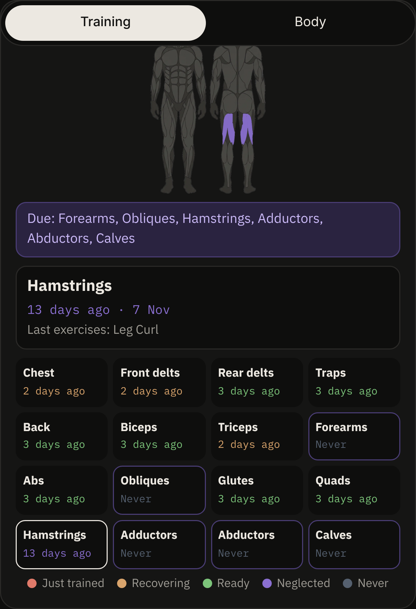

# Spec: การฟื้นตัวแสดงกล้ามครบทุกมัด

## หน้าจอ (สถิติ › การฝึก › การฟื้นตัวของกล้ามเนื้อ)
เรียงจากบนลงล่าง
1. **หุ่น** ระบายทุกมัดตามสถานะ (แตะช่องกล้าม → ไฮไลต์เฉพาะมัดนั้น)
2. **แถบ "ควรเล่น"** (แสดงเมื่อมี) รายชื่อมัดที่ *ยังไม่เคยเล่น* หรือ *ละเลย*
3. **กล่องรายละเอียด** (แสดงเมื่อแตะช่องกล้าม) ชื่อมัด · กี่วันก่อน · วันที่ · ท่าที่เล่นล่าสุด
4. **ตาราง 16 ช่อง (4 คอลัมน์)** ลำดับคงที่ตามร่างกาย:
   อก, ไหล่หน้า, ไหล่หลัง, บ่า / หลัง, หน้าแขน, หลังแขน, แขนท่อนล่าง / หน้าท้อง, ข้างลำตัว, ก้น, ต้นขาหน้า / ต้นขาหลัง, ขาใน, ขานอก, น่อง
   แต่ละช่อง: ชื่อมัด + สถานะ (ไม่มีชื่อท่า เพื่อให้พอดีจอ — ชื่อท่าอยู่ในกล่องรายละเอียด)
5. **คำอธิบายสี** 5 สถานะ

## สถานะ
| สถานะ | เงื่อนไข (วันนับจากครั้งล่าสุดที่เป็นกล้ามหลัก) | สี | ข้อความ |
|---|---|---|---|
| เพิ่งเล่น | 0–1 วัน | แดง `#e07a6a` | วันนี้ / 1 วันก่อน |
| กำลังฟื้น | 2 วัน | ส้ม `#d9a46c` | 2 วันก่อน |
| พร้อม | 3–7 วัน | เขียว `#7cc47a` | n วันก่อน |
| ละเลย | > 7 วัน | ม่วง `#8a6fd1` + กรอบม่วง | n วันก่อน |
| ยังไม่เคยเล่น | ไม่มีบันทึก | เทาฟ้า `#55606f` + กรอบม่วง | ยังไม่เคยเล่น |

> เปลี่ยนจาก intent: "ละเลย" ใช้ **ม่วง** แทนส้มเข้ม เพราะส้มชนกับ "กำลังฟื้น"

## ข้อมูล
- คำนวณจาก `logs` เหมือนเดิม (กล้ามหลักของแต่ละท่าจาก `musOf`, รวมค่าที่ผู้ใช้ตั้งเองในคลังท่า)
- ไม่มีข้อมูลใหม่ / ไม่แตะ D1

## ข้อความ (TH / EN)
ยังไม่เคยเล่น / Never · ละเลย / Neglected · ควรเล่น / Due · ท่าที่เล่นล่าสุด / Last exercises

## กรณีพิเศษ
- ยังไม่มีประวัติเลย: ทุกช่อง "ยังไม่เคยเล่น", แถบควรเล่นแสดง 16 มัด
- ความสูงการ์ด ≤ 1 จอ iPhone 16 Pro Max (mockup: 581 px จาก 739)
