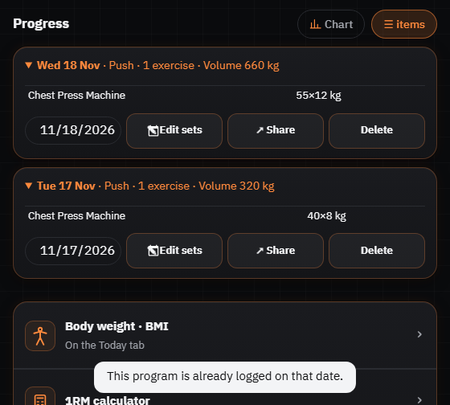

# Implementation and verification

- [x] Reproduced the bug on `f243202` in Chromium. Selecting the occupied date wrote both `gymdraft` and `gymlog`.
- [x] Updated the History date handler in `public/js/workout.js` and its asset version in `public/index.html`.
- [x] Verified zero writes for both a visible conflict and a conflict saved after opening History. Reload retained both complete workouts and the pending edit, which could still save to its source.
- [x] Verified moves to an empty date and a date with another program. An unrelated workout saved by another tab also survived the move.
- [x] Passed `npm test -- --history-edit`, `npm test`, and `node tests/api.mjs` against a fresh local D1 database.

