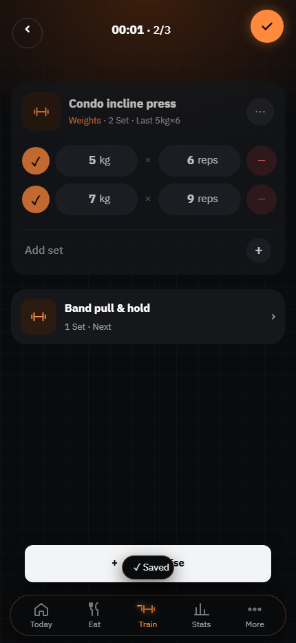
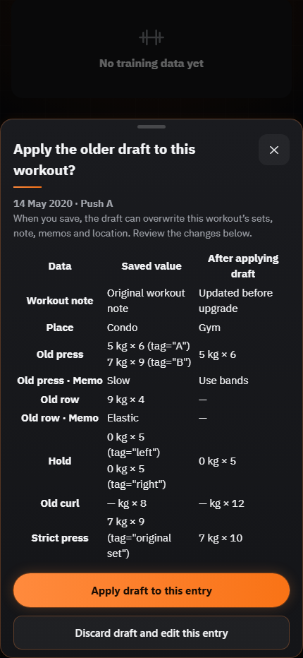

# Verification

- [x] Reproduced on main at `03f4179`. Changing 8 reps to 10 dropped both off-program exercises, their names and sets, annotations, timestamp, duration and set metadata. The location became Gym.
- [x] Restored the saved exercise list and carried untouched fields through Save. A historical draft can resume after a reload.
- [x] Verified rep edits, deleting a set or the only set in an exercise, clearing a memo, legacy entries and the original timestamp on a same-day edit. Run `npm test -- --history-edit` for the regression or `npm test` for the full smoke suite.
- [x] Verified a pre-upgrade draft with a deleted exercise, a deleted first set, and indistinguishable duplicate sets. Checked set-count increase, decrease and cancel through the number picker.
- [x] Moved and deleted the backing entry from History while its edit was open. Both cases kept the edit available and allowed discarding it without writing a log.
- [x] Replaced the original slot with a different workout using the same date, program and timestamp. Verified that Save rejects both moved and deleted originals and also checks the current browser storage before writing.

History offers Edit sets when the workout's program still exists. A deleted program remains viewable in the list.

New drafts carry the selected log's complete version across reloads. Selecting that version again resumes the draft. Selecting another entry offers an explicit choice to discard the open draft or cancel. An older draft without a version stays open for review. Select the intended History entry, compare the saved and proposed sets, note, memos and location, then choose whether to apply the draft. Save checks the selected version again.

Older drafts did not record a reliable set identity. A 5 kg × 6 row could be the original 5 kg × 6 set, or the 7 kg × 9 set after a deletion and rep/weight edit. Applying a legacy draft carries its entered weights and reps and omits unverifiable per-set fields. The comparison shows those fields before applying. New edits preserve them through their verified source indices.

