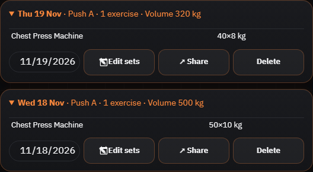

# Workout blank kg regression plan

- [x] Verify the QA-reviewed fixture reproduces all four failures on the base.
- [x] Apply weight validation to single tick, Tick all, clearing weight, and the shared save path. Bump the workout script's asset version.
- [x] Run the reviewed fixture, the bodyweight and zero controls, and the existing suite.
- [x] Reproduced the Nov 18/19 Push overwrite on `201bddf`. The reload regression now finds 50 kg × 10 on Nov 18 and the original 40 kg × 8 on Nov 19. A separate test covers a workout saved to the original slot by another tab before Finish and auto-save.
- [x] Confirmed re-ticking imported bodyweight History sets with null or omitted kg passed on `f243202` and failed on `201bddf`. Single tick and Tick all now preserve the stored representation through reload.
- [x] Ran both weight suites, focused History, the complete `npm test` suite and the isolated API suite. Plain `npm test` runs the weight regressions as well as History and smoke tests.

